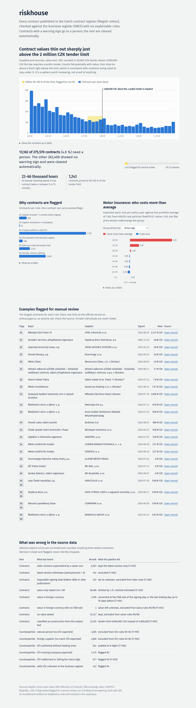

# riskhouse

Risk analytics on real public data: screening **Czech public contracts** for warning signs, and finding **who costs
what** in a real motor insurance portfolio. One lakehouse-style pipeline (dbt on DuckDB, verified on Databricks),
tested end to end.



## Why it matters

Every Czech public body must publish its contracts in **Registr smluv**, the public contract register: about
**94,000 records a month**. Checking suppliers by hand (does the company exist? was it founded last month?
is the price just under the tender limit?) is slow, so in practice almost nothing gets checked.

riskhouse does the first pass automatically. It matches every contract's supplier to **ARES**, the official
business register, applies six explainable rules, and sends only contracts with a warning sign to a person.

| July–September 2026 | |
|---|---|
| Contracts screened | **275,570** |
| Flagged for manual review | **13,162 (4.8 %)** |
| Cleared automatically | **262,408** |
| Reviewer time saved | **≈ 21,900–65,600 hours**, assuming 5–15 minutes to check one contract by hand |

A flag is a reason to look closer, **not a finding of wrongdoing**: each example on the dashboard links to the
official record so anyone can check it.

## What the data shows

1. **Contracts thin out sharply right above the 2 M CZK tender limit.** For supplies and services, contract counts
   fall gradually with value, then drop by about a third just above 2,000,000 CZK, the value at which the law
   requires a public tender. That is consistent with contracts being sized to stay under the limit. Rule R5 sends
   the 1,243 contracts priced at 90–100 % of the limit to review.
2. **Most warning signs are data quality, not behaviour.** 7,797 contracts name a company without a valid company ID
   (IČO), and 397 carry an impossible signing date (year 0001, year 2926). Fixing the register's data entry would
   remove most of the noise before anyone has to review it.
3. **A first draft of the splitting rule flagged a quarter of everything, and it was wrong.** Hospitals order drugs
   from wholesalers almost daily, and the first version of R6 read that as contract splitting (65,624 flags). The
   redesigned rule counts only 2–4 sizeable contracts within 30 days and flags 3,095 contracts. Checking a rule
   against real data before trusting it is the point.
4. **Motor insurance: a flat price would make the best drivers pay for the riskiest.** In 678,013 real policies,
   drivers aged 18–20 cost **5.0×** the average per policy-year; drivers with the best bonus-malus cost **0.67×**.
   Under one flat price those best drivers (225,000 policy-years) would overpay about **10.3 M EUR**.

## How it works

```
 Registr smluv XML ─┐        landing (text, as published)     bronze        silver (typed, cleaned)      gold
 ARES business reg. ─┼─ ingest/ ──► data/landing/*.parquet ──► views ──► contracts, parties, companies ──► screening R1–R6
 ČNB exchange rates ─┤                                                    exchange rates, motor policies     data-quality mart
 freMTPL2 (motor)   ─┘                                                                                       motor segments
                                                                                                                  │
                                                     dashboard/index.html ◄── export (aggregates only) ◄──────────┘
```

- **Land as-is, clean with rules.** Raw data is landed as text; every cleaning step happens in dbt, has an ID
  (`T-V03`, `R5` …) and is counted in a data-quality table. Obvious export errors are fixed and flagged; anything
  that needs a business decision is kept and flagged, never silently dropped.
  Full catalogue: [docs/transformation_rules.md](docs/transformation_rules.md).
- **Business owns the thresholds.** Tender limits, the "near limit" share, the splitting window and the VAT rate are
  dbt `vars` in `dbt_project.yml`, not numbers buried in SQL.
- **Explainable rules, not a black box.** A procurement reviewer or an auditor can read every rule.

| Rule | Warning sign | Contracts |
|---|---|---|
| R1 | Supplier founded less than 6 months before signing | 869 |
| R2 | Supplier dissolved or in liquidation | 61 |
| R3 | A company without a valid IČO (missing, malformed, failing the check digit) | 7,797 |
| R4 | Valid IČO unknown to the business register | 405 |
| R5 | Value at 90–100 % of the tender limit | 1,243 |
| R6 | 2–4 sizeable contracts with the same supplier within 30 days, together over the limit | 3,095 |

## Run it

```bash
python -m venv .venv && .venv\Scripts\activate        # macOS/Linux: source .venv/bin/activate
pip install -r requirements.txt
python pipeline.py all        # download -> land -> build -> dashboard (first run ~30 min, mostly ARES lookups)
```

Then open `dashboard/index.html`. Steps can run on their own: `download`, `land`, `build`, `dashboard`, `test`.
Raw data is never committed; the pipeline downloads it from the official open-data sources.

## Engineering

- **Tests.** 41 dbt checks: data tests on the real data (unique keys, allowed values, no flag ever unknown, every
  valid IČO looked up) and unit tests with one hand-made case per cleaning and screening rule, plus pytest for the
  landing code. Several real bugs were caught this way, e.g. flags that were silently NULL for most suppliers.
- **CI.** GitHub Actions runs pytest and the full dbt build on a small committed sample, offline
  ([.github/workflows/ci.yml](.github/workflows/ci.yml)).
- **Development on DuckDB, production on Databricks.** Engine-specific SQL sits behind macros with a DuckDB and a
  Spark version ([macros/cross_engine.sql](macros/cross_engine.sql)); a landing notebook loads the files into Delta
  tables ([notebooks/01_land.py](notebooks/01_land.py)); `dbt build --target databricks` runs the same models.
  **Verified on Databricks (Free Edition, serverless):** all 41 dbt checks pass, and 16 key metrics (contracts flagged,
  every rule count, total value to the haléř, motor claim cost) are identical to the local DuckDB build. Getting
  there found three real cross-engine differences, now fixed: float vs. exact decimal division for VAT and exchange
  rates, and accent stripping of Polish letters. Credentials only come from environment variables
  ([docs/databricks.md](docs/databricks.md)).
- **Security.** The XML parser refuses external entities and network access; the dashboard renders data as text
  only; no secrets in the repository.

## Known limitations

- Construction contracts are recognised by keywords in the subject (the register has no type field).
- Foreign suppliers are recognised by the country in their address; a foreign company with no country there can be
  flagged R3/R4.
- Some private individuals are not marked as such in the register and can be flagged R3. R3 precision is being
  measured by a manual review of a 30-contract sample.
- The hours-saved figure rests on the stated 5–15 minute assumption.
- The motor portfolio has no premiums, so it shows expected claim cost per segment, not loss ratios.

## Repository map

```
pipeline.py                     one entry point: download / land / build / dashboard / test
ingest/                         downloads and landing: contract XML, ARES lookups, ČNB rates, freMTPL2
models/procurement/             bronze -> silver -> gold for contract screening, unit tests per rule
models/motor/                   motor policies, claim cost, segment relativities
macros/                         DuckDB / Spark portable functions, IČO check digit, landing switch
tests/                          pytest, singular dbt tests, offline CI sample
dashboard/                      static dashboard and its data export
notebooks/01_land.py            Databricks landing notebook
docs/                           transformation rules, Databricks guide, checkpoints
```

Data: [Registr smluv open data](https://data.smlouvy.gov.cz/), [ARES](https://ares.gov.cz/) (Ministry of Finance),
[ČNB exchange rates](https://www.cnb.cz/), [freMTPL2](https://www.openml.org/d/41214) (CC0).
